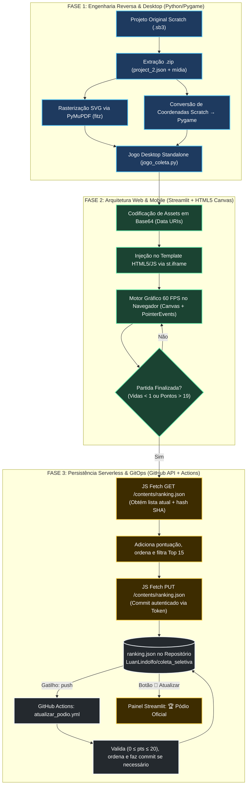

# Documentação Técnica e Arquitetura de Software

## Projeto: Desafio da Coleta Seletiva (Do Scratch `.sb3` à Arquitetura Web Serverless)

| Metadado | Valor |
| :--- | :--- |
| **Sistema** | Desafio da Coleta Seletiva (Desktop Pygame & Web App Leaderboard) |
| **Stack Tecnológica (Fase 1)** | Python 3, Pygame, PyMuPDF (`fitz`) |
| **Stack Tecnológica (Fase 2 & 3)** | Python 3, Streamlit, HTML5 Canvas, Vanilla JavaScript (ES6+), GitHub REST API v3, GitHub Actions |
| **Repositório Alvo** | `LuanLindolfo/coleta_seletiva` |
| **Ambiente Local Original** | `C:\Users\luanl\Downloads\coleta-seletiva_erros_Luan (1)` (`.venv` em `C:\Users\luanl\Downloads\testejogo\.venv`) |
| **Ambiente de Deploy Web** | Streamlit Community Cloud (`https://coletaseletiva1.streamlit.app`) |
| **Status** | Em Produção / Estável |

---

## 1. Visão Geral do Projeto

O **Desafio da Coleta Seletiva** é um jogo educativo de educação ambiental originalmente desenvolvido no **Scratch 3 (`.sb3`)**. O projeto passou por um ciclo completo de engenharia de software dividido em três grandes macro-fases:

1. **Portabilidade Desktop (`jogo_coleta.py`):** Engenharia reversa do pacote `.sb3` e reimplementação nativa em Python utilizando `Pygame` para renderização gráfica, controle de eventos, colisões e áudio, combinada com `PyMuPDF` (`fitz`) para rasterização de vetores `.svg`.
2. **Migração Web & Multiplataforma (`app.py`):** Conversão do motor de jogo para **HTML5 Canvas / JavaScript ES6+** embarcado em **Streamlit**, com empacotamento de mídia em *Data URIs* (Base64) e controles híbridos (Teclado + Touch Mobile).
3. **Persistência Serverless e GitOps (`ranking.json` + GitHub Actions):** Implementação de um Pódio Oficial Top 15 persistente utilizando o repositório GitHub como camada de armazenamento JSON e o GitHub Actions como *worker* assíncrono de validação e ordenação determinística.

---

## 2. Fluxograma Completo do Projeto (End-to-End)



---

## 3. Parte I — Conversão do Projeto Scratch (`.sb3`) para Python Desktop

### 3.1. Etapas Realizadas do Início ao Fim

#### Etapa 1: Compreensão da Estrutura de Arquivos `.sb3` e Conversão para `.zip`
Arquivos `.sb3` do Scratch 3 são pacotes compactados no formato `.zip`. Para acessar os elementos internos do projeto na pasta, o arquivo `.sb3` foi convertido/renomeado para `.zip` e extraído, liberando:
1. **`project.json` / `project_2.json`:** Descreve em formato JSON todos os alvos (*targets*), incluindo o palco (*Stage*), atores (`Sprite1`, `Lixeira`, `Lixo`, `Dica`), variáveis, transmissões (*broadcasts*), fantasias (*costumes*), sons (*sounds*) e a árvore de blocos (*blocks*). *(Nota: durante a investigação inicial, foi identificado um primeiro `.sb3` com estrutura limpa/vazia antes do envio do projeto completo do jogo em `project_2.json` com seus respectivos lotes de sprites e sons).*
2. **Arquivos de mídia (*assets*):** Imagens em formato `.svg`, `.png` ou `.jpg` e áudios em `.wav`.

#### Etapa 2: Tentativas de Conversão Automática e Diagnóstico
Antes da tradução direta e estruturada para Python, foram testadas abordagens automáticas:
* **Clonagem de repositório (`git clone`):** A tentativa de clonar o repositório `sb3topy` no GitHub resultou em `Repository not found`, impedindo o uso direto desse caminho.
* **Instalação via PyPI (`pip install sb3topy`):** O pacote não foi encontrado no índice oficial (`No matching distribution found for sb3topy`).
* **Ajuste de caminho no PowerShell:** Caminhos iniciados com barra no estilo Unix (como `/c:/Users/...`) geraram erro no PowerShell do Windows, sendo substituídos pela sintaxe nativa do Windows com aspas devido a espaços e parênteses no nome da pasta (`"C:\Users\luanl\Downloads\coleta-seletiva_erros_Luan (1)"`).

#### Etapa 3: Extração e Inventário dos Recursos (`project_2.json` e Mídia)

* **Cenários (*Stage*):**
  * `instrucoes`: `49c8433626dd2759e7cea2697335b886.svg`
  * `jogo`: `693507866d39d7257377845b34fa7426.png` (ou `.jpg` conforme o arquivo presente na pasta)
  * `fim`: `1c3010490bfc4f7d96f7f1756c21f9de.svg`
  * `vitoria`: `7e15832ed1b37bd73d3418030b27bc8e.svg`

* **Sons (*Stage* e `Lixo`):**
  * `fim`: `e3635ab50a93193e53cd16f047446add.wav`
  * `vitoria`: `b8251bb11c300af3582aba1239082d41.wav`
  * `acerto`: `cfc50a412483f6aadb83adeff596052e.wav`
  * `erro`: `768bd6a764ab62a6a6764e4147c3e615.wav`

* **Atores e Fantasias:**
  1. **`Sprite1` (Botão "Pressione ESPAÇO para começar"):**
     * *Fantasia `costume1`:* `83289741ad14f2292187479156d68b15.svg`
     * *Comportamento:* Aparece na tela de instruções, alterna o tamanho entre `100%` e `110%` a cada `0.3s` e se esconde ao iniciar o jogo.
  2. **`Lixeira`:**
     * *Fantasias (correspondentes às teclas `1` a `5`):*
       1. `papel`: `e0abe584a75ba6c8c5dbff995d9be90a.svg`
       2. `plastico`: `4bfcb0e25246a5ac747ae14778b9e751.svg`
       3. `vidro`: `d610b30c19b7e082ed98d0597592531b.svg`
       4. `metal`: `d388958fbb03f3ac73d464126f2b11f8.svg`
       5. `organico`: `506b5e3fb9f22601584dd04468c217c7.svg`
     * *Comportamento:* Começa oculta; ao receber `iniciar`, posiciona-se em $(x=0, y=-135)$ na fantasia `papel`, move-se horizontalmente ($dx = \pm 14$) com setas esquerda/direita ou teclas `A`/`D`, fica restrita ao intervalo $x \in [-205, 205]$ e troca de fantasia com as teclas `1` a `5`.
  3. **`Lixo` (Clones):**
     * *10 fantasias (`lixo1` a `lixo10`):*
       * `lixo1`: `750b6d248d55e43f035febc2ee61b693.svg`
       * `lixo2`: `b2946c689f98c56cc2ada16de60018b6.svg`
       * `lixo3`: `b5ac32ca01d749ce3b57e19b1ebcf8b0.svg`
       * `lixo4`: `9e6a1febff68f2f7427c406b27a378c8.svg`
       * `lixo5`: `d08c060f34f414e5d4274a1fe74c57c3.svg`
       * `lixo6`: `a380e70730f191243ddb989d1be972ea.svg`
       * `lixo7`: `c4f8588495bad0fb9cf808597db39fc3.svg`
       * `lixo8`: `e78af7aec183657375aff54ad57fefa9.svg`
       * `lixo9`: `80a6400b5fd9929c929a52b0aba67957.svg`
       * `lixo10`: `b8b976c0e35ef9fe7d816751c09aabc5.svg`
     * *Comportamento:* Após `1.0s` do início, cria clones a cada intervalo aleatório entre `1.1s` e `2.0s`. Cada clone sorteia `item` de `1` a `10`, calcula $\text{tipo} = ((item - 1) \bmod 5) + 1$, surge em $x$ aleatório $[-200, 200]$ e $y = 175$, e desce `velocidade` pixels por quadro.
     * *Colisão com Lixeira:* Se a fantasia da lixeira (`1` a `5`) corresponder ao `tipo` do clone, `Pontos` aumenta em `1` e toca `acerto`; caso contrário, reduz `Vidas` em `1` (se `Vidas > 0`), atualiza `UltimoTipo = tipo`, toca `erro` e aciona a transmissão `errou`.
     * *Queda abaixo de $y < -170$:* Reduz `Vidas` em `1`, toca `erro` e remove o clone.
  4. **`Dica`:**
     * *Fantasias (`dica1` a `dica5`):*
       * `dica1`: `943525abb609ad165c88c55dd37bc555.svg`
       * `dica2`: `561f2c58021e4ec10b58f009ef391431.svg`
       * `dica3`: `77c71fc36e7f8d5e6f9b239f1aa6ef0a.svg`
       * `dica4`: `7f683ab17ac6b7aac94b7af86074fbaa.svg`
       * `dica5`: `a7b7b55ac7696e64f8dfcd5102922329.svg`
     * *Comportamento:* Ao receber `errou`, exibe a fantasia correspondente a `UltimoTipo` em $(x=0, y=95)$ durante `2.6s` e depois oculta.

#### Etapa 4: Tradução da Lógica e Conversão de Coordenadas
* **Resolução e FPS:** Janela de $480 \times 360$ rodando a 30 FPS (`relogio.tick(30)`), compatível com o palco padrão do Scratch.
* **Sistema de coordenadas:** O Scratch utiliza $(0, 0)$ no centro com eixo $Y$ crescente para cima; o Pygame utiliza $(0, 0)$ no canto superior esquerdo com eixo $Y$ crescente para baixo. Foi criada a função `scratch_para_pygame(x, y, largura_img, altura_img, rot_center)` para converter as posições.
* **Progressão e condições de encerramento:**
  * `Pontos` inicia em `0`, `Vidas` em `5`, `Velocidade` em `3.0` e `UltimoTipo` em `1`.
  * A cada `6` segundos (`6000 ms`) durante o jogo, `Velocidade` incrementa em `+0.4`.
  * Vitória ocorre quando `Pontos > 19` (toca `vitoria` e muda para cenário `vitoria`).
  * Derrota ocorre quando `Vidas < 1` (toca `fim` e muda para cenário `fim`).
  * Após `2.5` segundos (`2500 ms`) na tela final ou de vitória, o loop encerra.

#### Etapa 5: Resolução do Problema de Renderização `.svg` (Tela Preta)
Na primeira execução, a janela abriu quase toda preta porque o carregamento nativo de `.svg` do Pygame não renderizou corretamente os vetores exportados pelo Scratch.
* **Solução aplicada:** Integração do **PyMuPDF (`fitz`)** na função `carregar_imagem()` para abrir arquivos `.svg`, rasterizá-los em memória com canal alfa (`alpha=True`) via `get_pixmap()` e convertê-los em PNG em memória (`io.BytesIO`) antes de carregar no Pygame.

### 3.2. Ferramentas, Linguagem e Execução Local (Versão Desktop)
* **Linguagem:** Python 3 (via ambiente virtual `.venv`).
* **Terminal / Shell:** Windows PowerShell.
* **Bibliotecas:** `pygame`, `pymupdf` (`fitz`), e módulos padrão (`os`, `io`, `random`).

Comando de execução no PowerShell:
```powershell
& "C:\Users\luanl\Downloads\testejogo\.venv\Scripts\python.exe" -m pip install pygame pymupdf
& "C:\Users\luanl\Downloads\testejogo\.venv\Scripts\python.exe" "C:\Users\luanl\Downloads\coleta-seletiva_erros_Luan (1)\jogo_coleta.py"
```

---

## 4. Parte II — Arquitetura Web, Multiplataforma e Persistência Serverless (`app.py`)

Para permitir acesso imediato via navegador em computadores e smartphones sem instalação local, além de incorporar as melhorias de feedback visual, pausa, áudio (mute) e recorde persistente, o sistema foi evoluído para uma arquitetura web baseada em **Streamlit + HTML5 Canvas + GitHub API**.

### 4.1. Diagrama de Componentes e Comunicação

```text
+-----------------------------------------------------------------------+
|                         Cliente (Navegador)                           |
|                                                                       |
|  +-------------------------------+   +-----------------------------+  |
|  |   Frontend Host (Streamlit)   |   |   Game Engine (st.iframe)   |  |
|  |                               |   |                             |  |
|  | - Input: Nome do Jogador      |   | - Canvas 2D (60 FPS)        |  |
|  | - Leitura do Pódio (GET)      |   | - Controles Touch / Teclado |  |
|  | - Renderização Top 10         |   | - Persistência Direta (PUT) |  |
|  +---------------+---------------+   +--------------+--------------+  |
+------------------|----------------------------------|-----------------+
                   | HTTPS (urllib)                   | HTTPS (fetch API)
                   v                                  v
+-----------------------------------------------------------------------+
|                       GitHub Cloud Infrastructure                     |
|                                                                       |
|  +-----------------------------------------------------------------+  |
|  | GitHub Contents API (/repos/{owner}/{repo}/contents/ranking.json)| |
|  +--------------------------------+--------------------------------+  |
|                                   |                                   |
|                                   v (Trigger: on push)                |
|  +-----------------------------------------------------------------+  |
|  | GitHub Actions Pipeline (.github/workflows/atualizar_podio.yml) |  |
|  | - Validação de intervalo (0 <= pontos <= 20)                    |  |
|  | - Ordenação decrescente por pontos e cronológica                |  |
|  | - Truncamento Top 15 & Commit automatizado                      |  |
|  +-----------------------------------------------------------------+  |
+-----------------------------------------------------------------------+
```

### 4.2. Decisões Arquiteturais (ADRs)

* **ADR-01 — Empacotamento de Assets via Data URI (`Base64`):**
  * *Contexto:* O componente embarcado em `st.iframe` opera sob políticas restritivas de origem (`srcdoc` / sandbox), impossibilitando o carregamento relativo direto de arquivos locais do servidor Streamlit.
  * *Decisão:* Converter imagens (`.svg`, `.png`, `.jpg`) e áudios (`.wav`) do diretório `./dependencias` em strings `data:<mime>;base64,...` no *backend* Python (`asset_to_data_uri`) e injetá-las no contexto JavaScript antes da renderização.
* **ADR-02 — Substituição de `st.components.v1.html` por `st.iframe`:**
  * *Contexto:* Depreciação oficial de `st.components.v1.html` (remoção prevista após `2026-06-01`) e incompatibilidade do parâmetro legado `scrolling`.
  * *Decisão:* Adoção de `st.iframe(html_jogo, height=495)` com fallback condicional (`hasattr(st, "iframe")`) e controle de transbordo via CSS (`overflow: hidden`).
* **ADR-03 — Persistência Assíncrona Direta via `fetch()` em vez de Redirecionamento `_top`:**
  * *Contexto:* O atributo `sandbox` aplicado pelo Streamlit ao `st.iframe` bloqueia navegações de janela superior (`target="_top"`) originadas dentro do frame, impedindo o envio de parâmetros via *Query String* (`st.query_params`).
  * *Decisão:* Executar o ciclo `GET` (obtenção do `sha` atual e desserialização UTF-8) $\rightarrow$ `PUT` (atualização atômica em Base64) diretamente do cliente JavaScript para a API REST do GitHub no evento de término de partida (`estado === "fim"` ou `estado === "vitoria"`).

### 4.3. Especificação dos Módulos Web

#### Aplicação Principal (`app.py`)
| Camada / Função | Responsabilidade Técnica |
| :--- | :--- |
| `ler_ranking_github()` | Realiza requisição `GET` autenticada (`Bearer Token`) na GitHub Contents API com *cache-busting* (`?t=<timestamp>`), decodifica o payload Base64 e ordena os registros por `(-pontos, data)`. |
| `asset_to_data_uri(nome_arquivo)` | Lê arquivos binários de `./dependencias`, infere o `MIME-Type` e retorna a URI Base64 correspondente, contabilizando eventuais ausências. |
| Motor Gráfico (`requestAnimationFrame`) | Executa o *game loop* em resolução lógica $480 \times 360\text{ px}$ (proporção $4:3$), gerenciando estados (`instrucoes`, `jogo`, `fim`, `vitoria`), controles híbridos (`PointerEvents` para mobile + teclado), colisão AABB (`rectsColidem`), pausa com compensação de *delta time*, áudio (*mute*), feedback visual (`+1 ♻️`, `-1 ❤️`, *screen shake*) e progressão de velocidade. |
| `registrarAutomaticamenteNoGitHub(pts)` | Executa o fluxo transacional na API do GitHub ao fim da partida, codificando caracteres UTF-8 via `TextEncoder` antes da conversão Base64 para preservar acentuação em nomes de jogadores. |
| Painel Lateral (`col_ranking`) | Exibe o status de conectividade com o GitHub, botão de sincronização manual (`st.rerun()`) e os 10 primeiros colocados do pódio oficial. |

#### Pipeline de CI/CD e Governança de Dados (`.github/workflows/atualizar_podio.yml`)
* **Gatilhos (`on`):**
  * `push` restrito ao caminho `ranking.json`.
  * `workflow_dispatch` para execução manual sob demanda.
* **Permissões (`permissions`):** `contents: write` (princípio do menor privilégio usando o `GITHUB_TOKEN` efêmero do runner).
* **Etapas de Execução (`jobs.ordenar-podio`):**
  1. `actions/checkout@v4`: Clona o estado atual do repositório.
  2. **Sanitização e Ordenação (Python):** Filtra registros fora da faixa válida ($0 \le \text{pontos} \le 20$), ordena por pontuação decrescente e mantém exclusivamente os 15 melhores resultados (`validos[:15]`).
  3. **Idempotência de Commit:** Verifica `git diff --quiet ranking.json`. Caso não haja alteração estrutural ou de ordem, encerra sem gerar commits redundantes. Caso contrário, efetua commit como `github-actions[bot]`.

#### Esquema de Dados (`ranking.json`)
```json
[
  {
    "nome": "Luan",
    "pontos": 20,
    "data": "23/11 22:05"
  }
]
```

| Campo | Tipo | Restrições | Descrição |
| :--- | :--- | :--- | :--- |
| `nome` | `string` | Máx. 20 caracteres, padrão `"Jogador"` | Identificador exibido no pódio. |
| `pontos` | `integer` | Intervalo fechado $[0, 20]$ | Pontuação obtida na partida. |
| `data` | `string` | Formato `DD/MM HH:MM` | Timestamp local do registro. |

---

## 5. Segurança e Configuração de Ambiente (Deploy)

### 5.1. Variáveis de Ambiente (`st.secrets`)
Configuradas no painel do Streamlit Cloud (*Settings* $\rightarrow$ *Secrets*):
```toml
GITHUB_TOKEN = "ghp_************************************"
GITHUB_REPO = "LuanLindolfo/coleta_seletiva"
```

### 5.2. Escopo de Acesso (PAT — Personal Access Token)
* **Escopo habilitado:** `repo` (controle de leitura e escrita de conteúdo no repositório alvo).
* **Segregação de privilégios:** Permissões administrativas (`admin:org`, `delete_repo`, `admin:public_key`, etc.) mantidas desabilitadas.

---

## 6. Registro de Incidentes e Soluções Aplicadas (Troubleshooting Log)

1. **Tela preta na renderização `.svg` (Fase Desktop Pygame):**
   * *Sintoma:* Pygame não renderizava vetores `.svg` exportados do Scratch.
   * *Resolução:* Rasterização em memória com canal alfa via `PyMuPDF` (`fitz`).
2. **Bloqueio de navegação pelo Sandbox do Iframe (Fase Web):**
   * *Sintoma:* Clique no botão de salvamento não disparava recarregamento nem gravava dados.
   * *Causa Raiz:* Restrição `sandbox` do iframe impedindo `target="_top"`.
   * *Resolução:* Migração da escrita para `fetch()` assíncrono direto na API REST do GitHub.
3. **Aviso de Depreciação da API Streamlit:**
   * *Sintoma:* Log `Please replace st.components.v1.html with st.iframe`.
   * *Resolução:* Substituição pelo componente nativo `st.iframe`.
4. **Exceção `TypeError` em parâmetro legado:**
   * *Sintoma:* `st.iframe() got an unexpected keyword argument 'scrolling'`.
   * *Resolução:* Remoção do argumento `scrolling=False` da assinatura de `st.iframe`.
5. **Autorização na API do GitHub:**
   * *Sintoma:* Falha na escrita em `ranking.json` por ausência de credenciais com escopo de escrita.
   * *Resolução:* Geração de PAT com escopo `repo` e configuração nos `Secrets` do Streamlit Cloud.

---

## 7. Roadmap de Evolução Futura

1. **Proxy Backend para Ocultação de Credenciais:** Migrar a chamada `PUT` da API do GitHub do JavaScript cliente para um endpoint intermediário (ex.: Cloudflare Worker ou Vercel Edge Function) ou disparo via webhook sem exposição do `GITHUB_TOKEN` no DOM do navegador.
2. **Assinatura Criptográfica de Partida (HMAC):** Reintroduzir validação de assinatura HMAC-SHA256 vinculada a um `partida_id` único no proxy/worker para mitigar envio forjado de pontuações via DevTools.
3. **Atualização Reativa Automática:** Substituir o botão manual `🔄 Atualizar` por polling leve ou componente bidirecional para atualizar o pódio automaticamente assim que o commit no GitHub for concluído.
