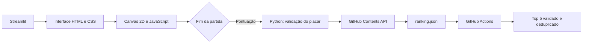

# Desafio da Coleta Seletiva

Jogo educativo desenvolvido em Python com Streamlit. O desafio ensina classificação de resíduos por meio de mecânicas arcade, cinco fases, três modos de jogo e persistência de placar no GitHub.

> Demonstração: https://coletaseletiva1.streamlit.app

## Recursos

- Cinco lixeiras: papel, plástico, vidro, metal e orgânico.
- Modos campanha, infinito e contra o relógio.
- Cinco fases, combos, vento, poderosos especiais e conquistas locais.
- Compatibilidade com teclado, toque e arraste.
- Ranking público com os cinco melhores jogadores.
- Enciclopédia de materiais, armadilhas e power-ups.
- Assets de imagem e áudio carregados em Base64.

## Arquitetura



## Tecnologias

- Python 3 e Streamlit.
- HTML5, CSS3 e JavaScript ES6.
- Canvas 2D e Pointer Events.
- GitHub Contents API e GitHub Actions.
- JSON para persistência do ranking.
- SVG, PNG e WAV para os assets.

## Estrutura

```text
.
├── app.py                         # Aplicação Streamlit, interface e motor web
├── jogo_coleta.py                 # Versão desktop em Pygame
├── dependencias/                  # Cenários, itens, sprites e sons
├── ranking.json                   # Top 5 oficial
├── requirements.txt               # Dependências Python
├── project.json                   # Estrutura importada do Scratch
└── .github/workflows/
    └── atualizar_podio.yml        # Validação e ordenação automática do ranking
```

## Execução local

Pré-requisitos:

- Python 3.10 ou superior.
- Pip instalado.

```bash
python -m pip install -r requirements.txt
streamlit run app.py
```

Acesse `http://localhost:8501`.

Para o ranking, configure em `.streamlit/secrets.toml`:

```toml
GITHUB_TOKEN = "seu_token"
GITHUB_REPO = "LuanLindolfo/coleta_seletiva"
```

O token precisa de permissão para ler e alterar `ranking.json`. Não envie o arquivo de secrets ou o token para o repositório.

## Controles

| Contexto | Controles |
|---|---|
| Movimento | Setas esquerda/direita, A/D ou arraste no canvas |
| Seleção | Teclas 1 a 5 ou botões das lixeiras |
| Jogar | Espaço ou botão Jogar |
| Pausar | Tecla P ou botão Pausar |
| Som | Tecla M ou botão Som |

## Mecânicas técnicas

- Canvas lógico de `480 × 360` pixels com proporção `4:3`.
- Loop contínuo por `requestAnimationFrame`.
- Detecção de colisão por caixas delimitadoras.
- Pontuação, vida, combo e fase controlados no estado do jogo.
- Assets convertidos em Data URIs para serem encapsulados no componente web.
- Ranking ordenado por pontuação, fase e nome do modo.
- `ranking.json` limitado aos cinco registros únicos mais relevantes.
- Workflow do GitHub Actions valida modos, limites e jogadores antes de concluir o Top 5.

## Limites de pontuação

| Modo | Limite |
|---|---:|
| Campanha | 40 pontos |
| Infinito | até 999 pontos |
| Contra o relógio | até 999 pontos |

## Modelo do ranking

```json
[
  {
    "nome": "Jogador",
    "pontos": 40,
    "fase": 5,
    "modo": "campanha",
    "data": "26/11 14:30"
  }
]
```

- `nome`: até 20 caracteres.
- `pontos`: inteiro dentro do limite do modo.
- `fase`: inteiro de 1 a 5.
- `modo`: `campanha`, `infinito` ou `tempo`.
- `data`: data e hora no formato `DD/MM HH:MM`.

## Automação do ranking

O workflow `.github/workflows/atualizar_podio.yml` é executado em alterações de `ranking.json` ou manualmente. Ele valida os registros, aplica limites por modo, remove duplicados por jogador, ordena o ranking e mantém somente os cinco melhores.

## Segurança

- O token do GitHub deve permanecer em Streamlit Secrets.
- Nenhuma credencial deve ser incluída no HTML ou no JavaScript enviado ao navegador.
- O workflow utiliza `GITHUB_TOKEN` com permissão limitada a `contents: write`.
- Recomenda-se migrar a gravação futura para um endpoint backend dedicado, evitando exposição de operações administrativas no cliente.
