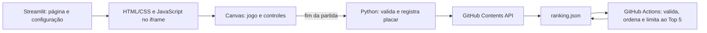

# Desafio da Coleta Seletiva

Jogo educativo de coleta seletiva feito com Python e Streamlit. O jogador classifica resíduos em cinco categorias, avança por fases e aprende sobre reciclagem em três modos: campanha, infinito e contra o relógio.

**Jogue:** [coletaseletiva1.streamlit.app](https://coletaseletiva1.streamlit.app)

## Como funciona



A interface é construída pelo Streamlit e o jogo roda no navegador, dentro de um `iframe`. O JavaScript atualiza o Canvas com `requestAnimationFrame`, recebe teclado/toque e controla colisões, pontuação, fases e itens. Ao terminar, envia os dados da partida à aplicação Python. O servidor valida o placar e usa a API do GitHub para atualizar o JSON; uma Action revisa e normaliza os registros.

## Ferramentas e decisões

| Ferramenta | Papel no projeto | Por que foi escolhida |
|---|---|---|
| **Python** | Configuração da aplicação, preparação de assets e comunicação com o ranking | Integra o painel, o processamento de dados e a API em um backend simples. |
| **Streamlit** | Página web, formulários, abas, enciclopédia e painel do Top 5 | Permite publicar uma aplicação Python sem desenvolver um servidor web separado. |
| **HTML, CSS e JavaScript** | Interface do jogo embutida no Streamlit | Dá controle sobre animação, entradas e apresentação no navegador. |
| **Canvas 2D** | Desenho dos cenários, resíduos, HUD e efeitos | É apropriado para redesenhar elementos de um jogo em tempo real. O canvas lógico é `480 × 360` (proporção 4:3). |
| **GitHub Contents API** | Leitura e gravação do `ranking.json` | Usa o próprio repositório como armazenamento simples, sem banco de dados externo. |
| **GitHub Actions** | Validação e manutenção automática do ranking | Mantém os dados consistentes após mudanças no arquivo e também permite execução manual. |
| **JSON** | Formato do placar | É legível, compacto e fácil de processar com a biblioteca padrão do Python. |
| **SVG, PNG e WAV** | Cenários, sprites, ilustrações e efeitos sonoros | Armazenam os recursos visuais e de áudio usados pelo jogo. São convertidos para Data URIs ao preparar o iframe, evitando depender de caminhos locais dentro dele. |

O CSS também carrega fontes do Google Fonts e a biblioteca Augmented UI para acabamento visual; são recursos externos da interface, não pacotes Python.

## Código e organização

- **`app.py`** — entrada principal da versão web. Define a interface e o iframe, prepara os recursos, implementa leitura/gravação do ranking e apresenta o Top 5 e a enciclopédia. A lógica de jogo dentro do iframe usa JavaScript.
- **`jogo_coleta.py`** — implementação alternativa/versão anterior da aplicação. Para executar a versão web atual, use `app.py`.
- **`dependencias/`** — imagens e sons usados no jogo.
- **`ranking.json`** — registros do placar oficial.
- **`requirements.txt`** — dependências Python instaladas pelo pip.
- **`project.json`** — arquivo de dados do projeto original do Scratch; serve como referência do projeto e não é necessário para iniciar a aplicação web.
- **`.github/workflows/atualizar_podio.yml`** — workflow que valida, deduplica e ordena o Top 5.

### Fluxo do jogo

1. O Streamlit coleta apelido e modo e prepara as imagens/sons para a página.
2. O navegador atualiza o jogo, movimenta os objetos e verifica colisões a cada quadro.
3. Acertos e erros alteram pontos, vidas ou tempo; as pontuações também atualizam recordes e conquistas salvos localmente no navegador.
4. No encerramento, o resultado é enviado à aplicação Python. O servidor valida modo, faixa de pontos e fase, remove repetições por jogador e atualiza o ranking.
5. A Action verifica os dados novamente, ordena por pontos e fase, remove nomes duplicados e conserva até cinco jogadores.

## Dependências

O `requirements.txt` declara **Streamlit**. O restante dos módulos Python usados para JSON, Base64, caminhos, datas e requisições HTTP pertence à biblioteca padrão do Python. O jogo web usa APIs nativas do navegador, como Canvas, Pointer Events e `localStorage`.

`jogo_coleta.py` é uma implementação alternativa e não é iniciado pelo comando abaixo. A lista mínima de dependências descrita aqui corresponde à entrada `app.py`.

## Executar localmente

Requisitos: Python 3 e pip.

```bash
python -m pip install -r requirements.txt
streamlit run app.py
```

Abra `http://localhost:8501`. Sem credenciais, a aplicação pode iniciar, mas a leitura e o registro do ranking no GitHub não estarão disponíveis.

Para habilitar o placar, configure `.streamlit/secrets.toml` localmente ou os **Secrets** no Streamlit Community Cloud:

```toml
GITHUB_TOKEN = "seu_token"
GITHUB_REPO = "LuanLindolfo/coleta_seletiva"
```

Use uma credencial com acesso somente ao conteúdo necessário. Não coloque tokens no código, no HTML/JavaScript ou no Git. Em produção, o valor é lido no servidor via `st.secrets`; o navegador envia os dados do placar à aplicação, que faz a chamada autenticada à API.

## Controles

| Ação | Controles |
|---|---|
| Mover a lixeira | Setas, A/D ou arrastar no canvas |
| Escolher material | Teclas 1–5 ou botões na tela |
| Iniciar | Espaço ou botão Jogar |
| Pausar/continuar | P ou botão Pausar |
| Ativar/desativar som | M ou botão Som |

## Regras técnicas do placar

| Campo | Especificação |
|---|---|
| `nome` | Até 20 caracteres; nomes repetidos não ocupam mais de uma posição. |
| `pontos` | Inteiro entre 0 e 40 na campanha; entre 0 e 999 nos outros modos. |
| `fase` | Inteiro de 1 a 5. |
| `modo` | `campanha`, `infinito` ou `tempo`. |
| `data` | Data/hora no formato `DD/MM HH:MM`. |

O workflow é acionado quando `ranking.json` muda ou manualmente. Ele valida o modo e os limites, ordena por pontos e fase, mantém um registro por nome e grava no máximo cinco entradas. Sua permissão de escrita é limitada a `contents: write`.

## Segurança e limitações

A validação no servidor e no workflow ajuda a manter o arquivo consistente, mas um placar público enviado por uma aplicação web não prova, por si só, que a pontuação foi obtida sem adulteração. Para maior resistência a fraude, o registro pode evoluir para um serviço backend com validação e proteção contra abuso. Proteja o token nos Secrets e conceda somente as permissões indispensáveis.
